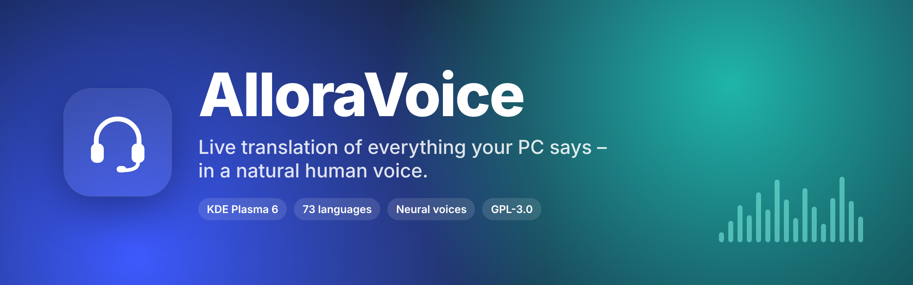
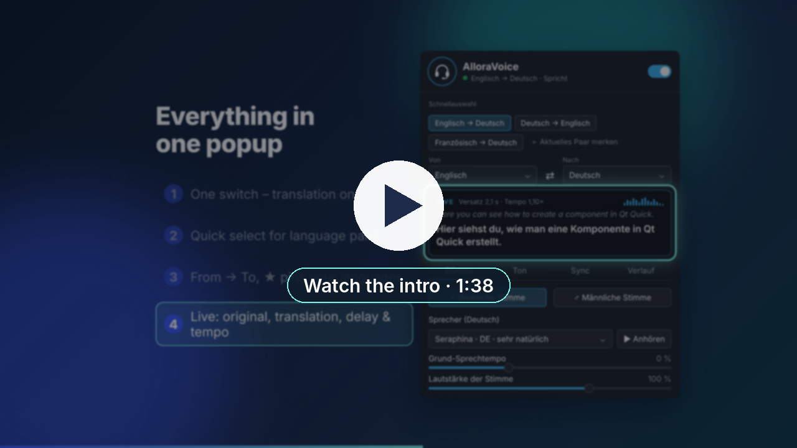
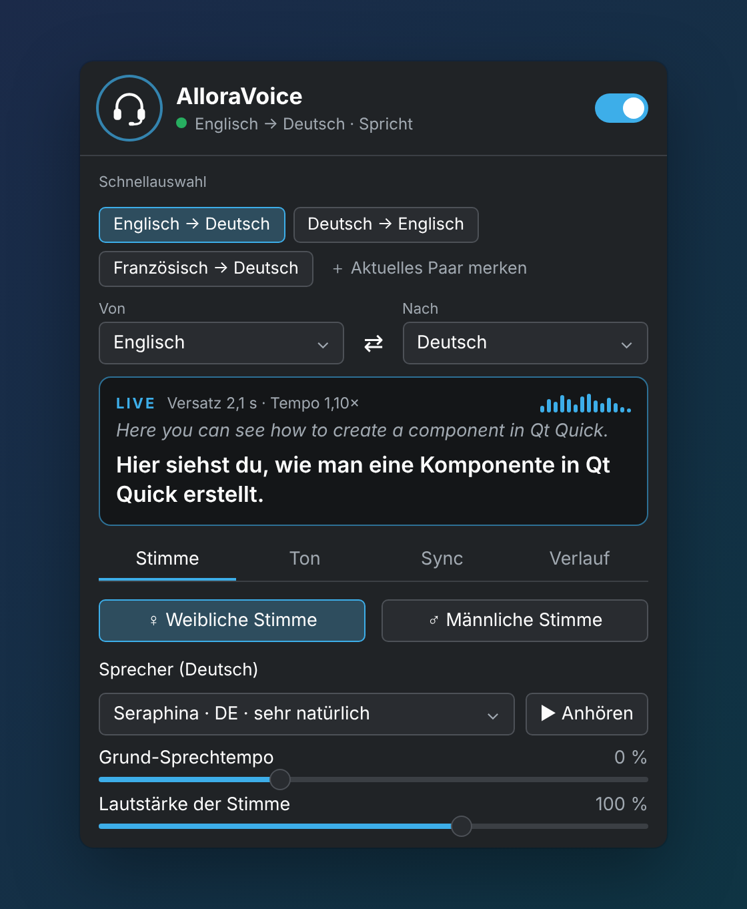
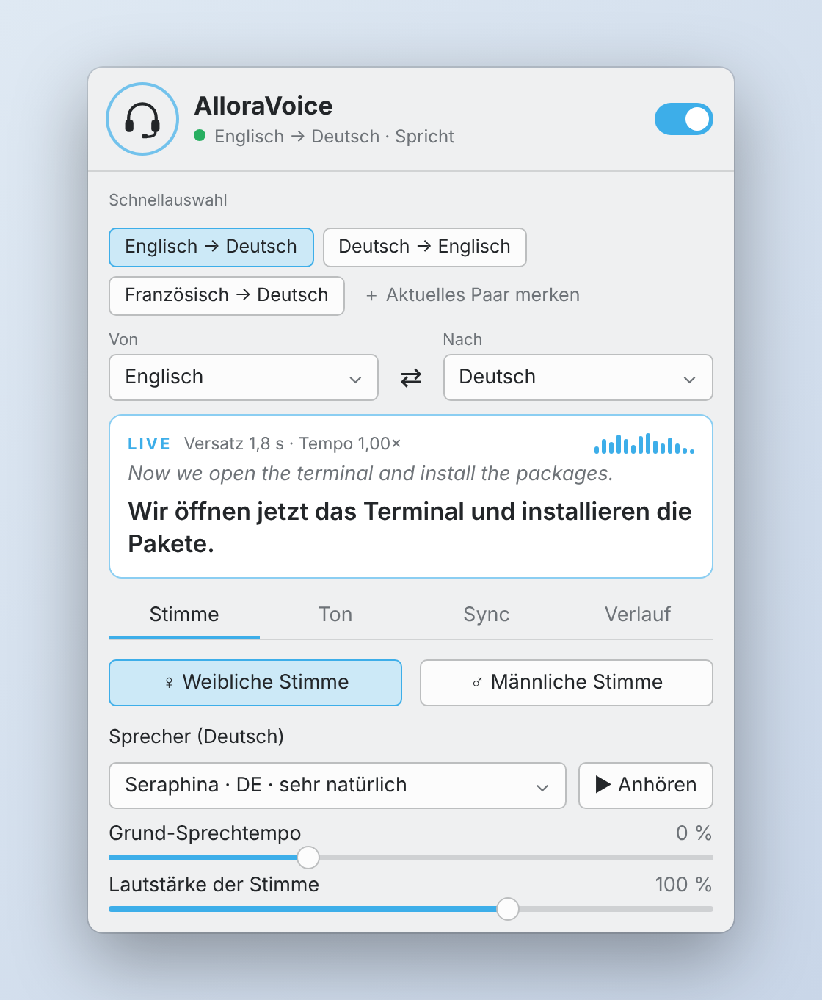
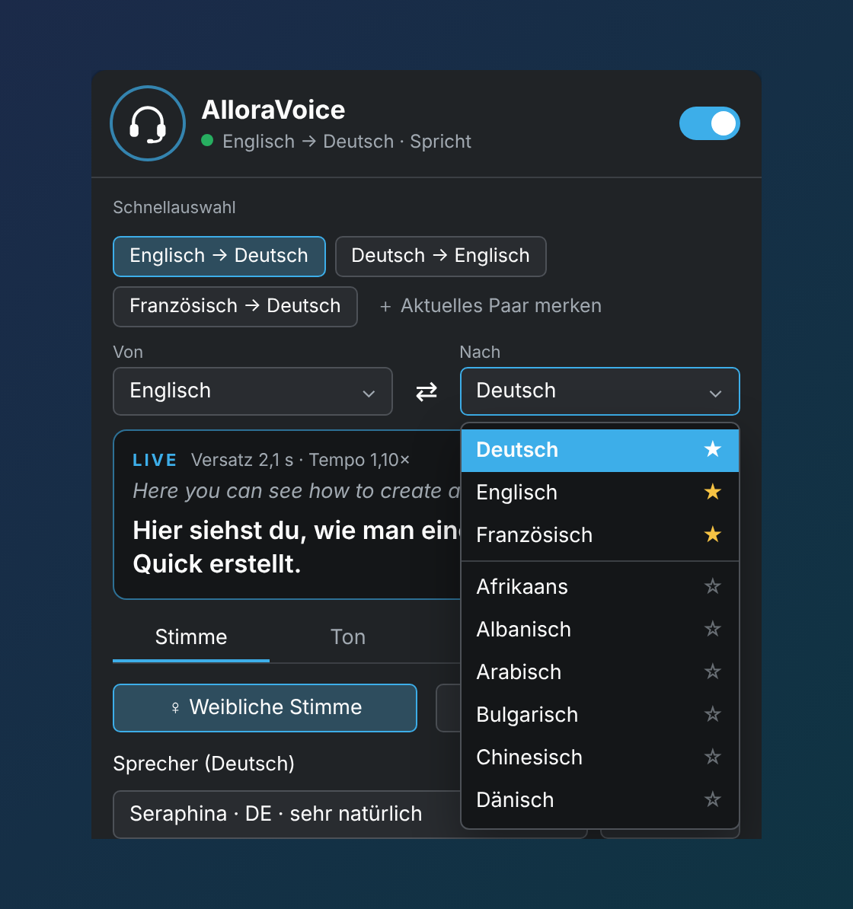
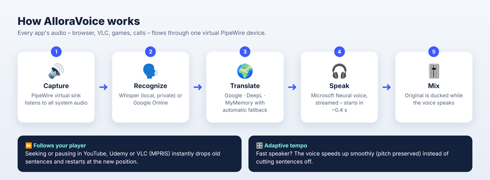

<div align="center">



# AlloraVoice

**A KDE Plasma 6 widget that listens to everything your PC plays and speaks it in your language – live, with a natural neural voice.**

YouTube · Udemy · Coursera · VLC · podcasts · games · video calls – if it comes out of your speakers, AlloraVoice can translate it.

[](LICENSE)


[Video](#-watch-the-intro) · [Features](#-features) · [Installation](#-installation) · [How it works](#%EF%B8%8F-how-it-works) · [FAQ](#-troubleshooting--faq)

</div>

---

## 🎬 Watch the intro

<div align="center">


  
</a>

<sub>1 min 38 s · 1080p · <a href="docs/video/alloravoice-intro.mp4">download MP4</a> · <a href="docs/video/alloravoice-intro.en.srt">subtitles</a></sub>
</div>

<!--
  Tip for the repository owner: GitHub only plays videos inline if they are uploaded as an attachment.
  Edit this README on github.com, drag docs/video/alloravoice-intro.mp4 into the editor and replace
  the thumbnail block above with the generated https://github.com/user-attachments/assets/… link.
-->

---

## ✨ Features

| | |
|---|---|
| 🔊 **System-wide** | Captures *all* audio through a virtual PipeWire device – browser, media players, games, calls. No browser extension needed. |
| 🗣️ **Natural voices** | Every Microsoft neural voice (e.g. *Seraphina*, *Florian*, *Ava*, *Andrew*), female or male, loaded live so new voices appear automatically. |
| 🌍 **73 languages** | Any-to-any: pick **From → To**, or let AlloraVoice **detect** the spoken language. |
| ⏩ **Follows your player** | Seeking or pausing in YouTube, Udemy, VLC … (MPRIS) instantly drops old sentences and restarts at the new position. |
| 🎛️ **Adaptive tempo** | Fast speaker? The voice speeds up smoothly – **pitch preserved, never cut off mid-sentence**. |
| ⚡ **Low latency** | Streamed speech starts after ~0.4 s; recognition runs on short segments. |
| 🎚️ **Smart ducking** | The original is turned down while the voice speaks – like a real dub. Presets: *Translation only*, *Dub*, *Interpreter*, *Both equal*. |
| 🔐 **Private recognition** | Speech recognition runs **locally** with Whisper (tiny / base / small) – or use Google Online if your CPU is slow. |
| 🔁 **Robust translation** | Google → Google 2 → MyMemory chain with automatic fallback, rate limiting and caching. Optional **DeepL** API key for top quality. |
| ⭐ **Quick select** | Save language pairs as one-click chips and pin your favorite languages to the top of every list. |
| 💬 **Floating subtitles** | Optional always-on-top subtitle window (original + translation), draggable anywhere. |
| 🎨 **Fits your desktop** | Uses the colors of your system color scheme and **the language of your system** (English, German – more welcome). |
| 📜 **History** | Every translated sentence with timestamp – copy everything with one click. |

---

## 🖼️ Preview

<div align="center">
<table>
<tr>
<td align="center"><br><sub>Dark color scheme</sub></td>
<td align="center"><br><sub>Light color scheme</sub></td>
</tr>
<tr>
<td align="center" colspan="2"><br><sub>Pin languages with ★ – they stay on top</sub></td>
</tr>
</table>

<sub>Illustrations of the widget popup, shown with a German system language. The interface follows the language set in <i>System Settings → Region &amp; Language</i>.</sub>
</div>

---

## ⚙️ How it works



```
 Apps ──► [ AlloraVoice virtual sink ] ──monitor──► Whisper ──► Translator ──► Neural voice ──┐
                    │                                                                         ▼
                    └──── loopback (volume = original / ducking) ─────────────────────► 🔊 Speakers
```

1. **Capture** – AlloraVoice creates a virtual PipeWire sink and moves your apps onto it. A loopback sends the original on to your speakers, so nothing is lost and there is no feedback loop.
2. **Recognize** – Speech is cut at natural pauses and transcribed by [faster-whisper](https://github.com/SYSTRAN/faster-whisper) on your CPU (or Google Online).
3. **Translate** – Google / DeepL / MyMemory, with automatic fallback when a service is busy.
4. **Speak** – A Microsoft neural voice is **streamed** and played as soon as the first audio arrives. The next sentence is fetched while the current one is still playing.
5. **Mix & sync** – The original is ducked while the voice speaks. Speaking rate is planned per sentence, and playback speeds up smoothly (up to 1.35×, pitch preserved) when sentences queue up. Seek/pause events from your player reset everything instantly.

The widget (QML) talks to a small Python service on `127.0.0.1:47820` that does all the audio work. Switching translation off restores your original audio routing.

---

## 📦 Requirements

| | |
|---|---|
| Desktop | **KDE Plasma 6** (Wayland or X11) |
| Audio | **PipeWire** with `pipewire-pulse` (default on current distributions) |
| Distribution | Fedora · Arch · openSUSE · Debian / Ubuntu / KDE neon – the setup detects `dnf`, `pacman`, `zypper` and `apt` |
| Python | 3.11 – 3.13 (Whisper wheels may lag behind the newest Python) |
| Internet | Needed for translation and voices (recognition can run fully offline) |
| Disk | ~400 MB (Python environment + Whisper models) |

---

## 🚀 Installation

### 1. Install the widget

**Option A – graphical (recommended)**

1. Download **`alloravoice-<version>.plasmoid`** from the [**Releases**](../../releases/latest) page.
2. Right-click your panel → **Add Widgets…** → **Get New** → **Install Widget From Local File…** → choose the file.
3. Search for **AlloraVoice** and drag it into your panel.

**Option B – terminal**

```bash
kpackagetool6 -t Plasma/Applet -i alloravoice-2.5.3.plasmoid      # first install
kpackagetool6 -t Plasma/Applet -u alloravoice-2.5.3.plasmoid      # update
```

**Option C – from source**

```bash
git clone https://github.com/Swenix-dev/AlloraVoice.git
cd AlloraVoice
./build.sh                                   # → dist/alloravoice-<version>.plasmoid
kpackagetool6 -t Plasma/Applet -i dist/alloravoice-*.plasmoid
```

### 2. One-time setup

Click the **headset icon** → **Set up now**. A Konsole window opens and installs everything into `~/.local/share/alloravoice` – no system Python packages are touched:

- system tools if missing: `pactl` / `parec` / `pacat` (PulseAudio utils on top of PipeWire)
- a private Python environment with `faster-whisper`, `edge-tts`, `deep-translator`, `SpeechRecognition`, `av`, `numpy`, `dbus-next`
- the Whisper models `base.en` and `base` (~300 MB, downloaded once)

### 3. Go!

Flip the switch, play a video – done. Tip: **middle-click** the panel icon to toggle translation without opening the popup.

<details>
<summary><b>Uninstall</b></summary>

```bash
kpackagetool6 -t Plasma/Applet -r org.seaq.alloravoice
rm -rf ~/.local/share/alloravoice
```
</details>

---

## 🎛️ Settings at a glance

| Tab | Setting | What it does |
|---|---|---|
| **Top** | Quick select | One-click language pairs. *＋ Save current pair* stores the current pair, right-click removes one. |
| | From → To | Source and target language. ★ in the list pins a language to the top, ⇄ swaps both. |
| **Voice** | Female / male, speaker | All neural voices for the target language. ▶ plays a sample. |
| | Base rate, pitch, volume | Personal fine-tuning of the voice. |
| **Sound** | Original volume, ducking | How loud the original stays, and how far it is lowered while the voice speaks. |
| | Presets | *Translation only* · *Dub* · *Interpreter* · *Both equal* |
| | Subtitle window | Floating, draggable live subtitles (optionally with the original text). |
| **Sync** | Follow seek & pause | React to seeking/pausing in your player (MPRIS). |
| | Adaptive tempo | Speed the voice up smoothly instead of falling behind. |
| | Emergency jump | Only if even the faster tempo is not enough: skip to the current position *between* sentences (default 8 s backlog). |
| | Recognition | Whisper Tiny / Base / Small (local) or Google Online. |
| | Responsiveness | Fast (short segments) · Balanced · Precise (more context). |
| | Translator | Google (free) or DeepL (API key – the free plan includes 500,000 characters/month). |
| **History** | | All translated sentences with time, copy all, clear. |

---

## 🌍 Adding a language

All languages live in [`package/contents/ui/languages.js`](package/contents/ui/languages.js) – one line each:

```js
//  code   name (UI)      Whisper  speech locale  Google  DeepL target  voice prefix
L("fr",  "Französisch",  "fr",    "fr-FR",       "fr",   "FR",         "fr-"),
```

Voices are **not** listed there: AlloraVoice downloads the complete Microsoft voice list and shows every voice whose locale starts with the voice prefix. A language only appears under **To** if at least one voice exists for it.

---

## 🗣️ Translating the interface

AlloraVoice uses the standard KDE translation system (gettext, `i18n()`), so the interface automatically follows **System Settings → Region & Language**. Included: **English** (default) and **German**. Any other system language falls back to English.

Adding a language, e.g. French:

```bash
cp po/de.po po/fr.po          # or: msginit -i po/alloravoice.pot -l fr -o po/fr.po
# translate the msgstr lines in po/fr.po (Lokalize, Poedit or any text editor)
./po/compile.sh               # → package/contents/locale/fr/LC_MESSAGES/plasma_applet_org.seaq.alloravoice.mo
./build.sh
```

After changing UI texts, run `./po/extract.sh` to update the template and all `.po` files. Language names in the From/To lists are translated too (see `langNames` in `main.qml`).

---

## 🔒 Privacy & online services

- **Speech recognition** with Whisper runs entirely on your computer. With *Google Online* the audio snippets are sent to Google.
- **Translation** sends the recognized *text* to Google, MyMemory or DeepL (your choice).
- **Voices** send the translated *text* to Microsoft's online text-to-speech service (the one behind *Read aloud* in Microsoft Edge).
- AlloraVoice has no telemetry and no account. The DeepL key is stored in your Plasma widget configuration.

---

## 🧰 Troubleshooting / FAQ

<details>
<summary><b>The voice lags behind the video</b></summary>

A delay of about 1.5–3 s is normal – a sentence has to be heard before it can be translated (live interpreters work the same way). To reduce it: set *Sync → Responsiveness* to **Fast**, use **Whisper Tiny** or **Google Online** on slower CPUs, or play the video at 0.9×.
</details>

<details>
<summary><b>“Too many requests” / translation errors</b></summary>

Free translation services limit request rates. AlloraVoice automatically falls back to the next service and pauses a blocked one for two minutes. For heavy use, add a free DeepL API key under *Sync → Translator*.
</details>

<details>
<summary><b>I hear nothing / my audio is gone after a crash</b></summary>

The routing is restored automatically on the next start. To fix it right away:

```bash
pactl list short modules | grep alloravoice    # show leftovers
systemctl --user restart pipewire pipewire-pulse wireplumber
```
Then pick your speakers again in the Plasma volume applet if needed.
</details>

<details>
<summary><b>Whisper does not install</b></summary>

Very new Python versions sometimes have no `faster-whisper` wheels yet. Install Python 3.12 (e.g. `sudo dnf install python3.12`), delete `~/.local/share/alloravoice` and run the setup again – it prefers 3.12 automatically. Meanwhile, choose *Google Online* as recognition.
</details>

<details>
<summary><b>Seeking is not detected</b></summary>

The player must publish MPRIS (Chrome/Chromium, Firefox, VLC, mpv with plugin … do). Check *Sync → Follow seek & pause*. Without MPRIS, AlloraVoice still catches up through adaptive tempo.
</details>

<details>
<summary><b>Where are the logs?</b></summary>

`~/.local/share/alloravoice/backend.log`
</details>

---

## 🛠️ Development

```
AlloraVoice/
├── package/                         # the Plasma widget (KPackage)
│   ├── metadata.json
│   └── contents/
│       ├── ui/                      # QML: main, popup, language picker, subtitles, languages.js
│       ├── config/main.xml          # widget settings
│       └── backend/
│           ├── alloravoice_backend.py   # audio routing, Whisper, translation, TTS, sync
│           ├── setup.sh                 # one-time setup (venv + models)
│           └── run.sh                   # starts the service
│       └── locale/                  # compiled translations (.mo)
├── po/                              # translations: template, de.po, extract.sh, compile.sh
├── docs/                            # images, intro video, narration script
├── build.sh                         # → dist/alloravoice-<version>.plasmoid
└── LICENSE
```

The backend can be run on its own for debugging:

```bash
~/.local/share/alloravoice/venv/bin/python package/contents/backend/alloravoice_backend.py
curl -s 127.0.0.1:47820/status | python3 -m json.tool
```

| Endpoint | |
|---|---|
| `GET /ping` · `GET /status` · `GET /config` · `GET /voices` | health, live state, current config, voice list |
| `POST /start` · `POST /stop` | start / stop translation (body = config) |
| `POST /config` · `POST /test` · `POST /clear` · `POST /quit` | update settings, play voice sample, clear history, shut down |

The intro video can get a voice-over with any neural voice: `docs/video/add-narration.sh` (needs ffmpeg).

---

## 🤝 Contributing

Issues and pull requests are welcome! Especially helpful:

- **UI translations** – see [Translating the interface](#%EF%B8%8F-translating-the-interface)
- testing on other distributions and audio setups
- real screenshots and demo clips

Please keep the code under GPL-3.0-or-later and add an SPDX header to new files.

---

## 📜 License

AlloraVoice is free software: you can redistribute it and/or modify it under the terms of the **GNU General Public License v3.0** (or, at your option, any later version). See [`LICENSE`](LICENSE).

Third-party components (faster-whisper, edge-tts, deep-translator, SpeechRecognition, PyAV, NumPy, dbus-next) are installed separately during setup and keep their own licenses.

> **Disclaimer** – AlloraVoice is an independent project and is not affiliated with or endorsed by KDE, Microsoft, Google, DeepL, YouTube or Udemy. It uses publicly reachable online services whose availability and terms may change. Please respect the terms of service of the content you translate.

<div align="center">
<br>
Made with 🎧 for everyone learning from content in another language.
</div>
